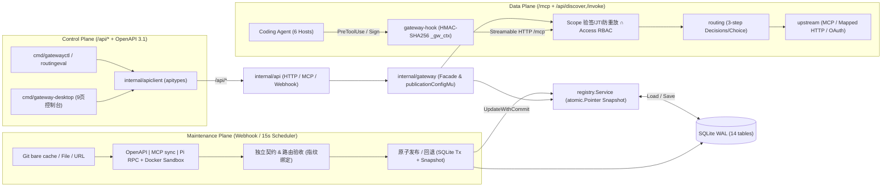
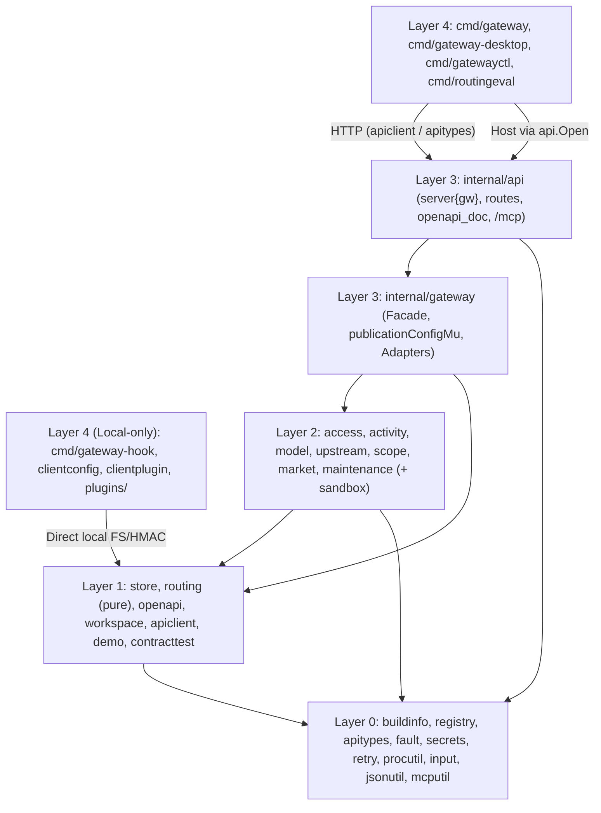

# 系统架构总览

本文档描述 MCP Gateway 的运行时拓扑、包分层依赖、核心运行不变量与存储/渠道隔离模型。工具路由策略的实测原理与数据见 [tool-routing](routing.md)，控制面 HTTP API 契约见 [docs/api](api/README.md)。

---

## 1. 系统定位与三面拓扑（Overview & Runtime Planes）

MCP Gateway 是面向本地 Coding Agent 的工具发现与执行网关。它向 Agent 固定暴露三个 MCP 元工具——`discover_tools`、`get_tool_schema` 与 `invoke_tool`，在网关侧通过 Decisions 模型从已授权工具目录中按需筛选小集合工具，避免将全量上游 Schema 注入主模型上下文。

系统按职责划分为三个正交运行面：

1. **Control Plane（控制面）**：围绕 `/api/*` REST 接口、[`internal/apitypes`](../internal/apitypes) 线缆契约与 OpenAPI 3.1 文档 [`docs/api/openapi.json`](api/openapi.json) 构建。MyGo 原生桌面端（[`cmd/gateway-desktop`](../cmd/gateway-desktop)，9 页控制台）、命令行工具（[`cmd/gatewayctl`](../cmd/gatewayctl)）及路由评测（[`cmd/routingeval`](../cmd/routingeval)）通过类型化 HTTP 客户端（`internal/apiclient`）访问后端；桌面端内嵌宿主仅经 `api.Open` / `api.Instance` 托管 listener，禁止绕过 HTTP 契约直接调用领域层。
2. **Data Plane（数据面）**：本地 Coding Agent（Codex CLI / Claude Code / Cursor / OpenCode v2 / Pi / Antigravity）触发调用时，本机 [`cmd/gateway-hook`](../cmd/gateway-hook) 采集工作区与 Git 锚点并对请求参数规范化哈希，签发 `v1` HMAC-SHA256 上下文凭证注入 `_gw_ctx`（Dev 渠道为 `_gw_ctx_mcp_gateway_dev`）或 `X-Gateway-Scope`。网关在 `/mcp`（Streamable HTTP）或 `/api/discover`、`/api/invoke` 入口验签与防重放后，求取「主体 RBAC × 仓库作用域」双重授权交集，执行三步 Decisions 路由，校验入参 Schema，最后分发至上游（stdio / Streamable HTTP MCP、OpenAPI 映射 HTTP 或沙箱隔离 `.mjs` 适配器），并在字段投影之前完成响应脱敏。
3. **Maintenance Plane（维护面）**：由仓库 Webhook（GitHub / GitLab / Generic 验签持久化队列）或 15 秒周期调度驱动，从本地文件、直连 URL（禁用重定向）或网关自有 bare Git 缓存拉取规格；按来源格式选择 OpenAPI 3.0/3.1 确定性导入、原生 MCP `tools/list` 同步，或由宿主 Pi RPC 驱动无网 Docker 编码沙箱（128 MiB tmpfs）生成适配器与 `verify.mjs`；随后运行独立负责人契约与路由验收（用例存储在独立表中，对 Pi 不可见），最终在指纹校验通过后经单一事务原子发布至工具注册表或执行版本回退。

---

## 2. 包分层与依赖边界（Package Layering & Dependency DAG）

所有 `internal/*` 包严格遵循自底向上的有向无环依赖（DAG），上层组合根与传输层向下编排领域服务，禁止任何同层循环或反向依赖：

| 层级 | 包 | 职责与硬性约束 |
| --- | --- | --- |
| **Layer 0**（基础叶节点与线缆契约） | [`buildinfo`](../internal/buildinfo), [`registry`](../internal/registry), [`apitypes`](../internal/apitypes), [`fault`](../internal/fault), [`secrets`](../internal/secrets), [`retry`](../internal/retry), [`procutil`](../internal/procutil), [`input`](../internal/input), [`jsonutil`](../internal/jsonutil), [`mcputil`](../internal/mcputil) | 零内部依赖（不导入任何其他 `internal/*`）。定义领域核心模型（`Server`/`Tool`/`Registry`）、线缆 DTO（`apitypes`）、跨层错误分类（`fault`）、编译期渠道身份（`buildinfo`）、进程隔离与环境变量原语（`procutil`）及有界 JSON/输入辅助。 |
| **Layer 1**（持久化、密码学与纯引擎） | [`store`](../internal/store), [`routing`](../internal/routing), [`openapi`](../internal/openapi), [`workspace`](../internal/workspace), `apiclient`, [`demo`](../internal/demo), [`contracttest`](../internal/contracttest) | `store` 是 SQLite DDL/SQL 与迁移的唯一拥有者；`routing` 为纯零 I/O 策略引擎（禁止 `database/sql`、`net/http`、`os`、`log/slog`、`sync`、`sync/atomic`）；`openapi` 负责 OpenAPI 3.0/3.1 解析与 HTTP 参数/响应绑定；`workspace` 负责工作区识别、Git `common_dir` 锚点及 HMAC scope token；`apiclient` 封装基于 `apitypes` 的 `/api` 类型化客户端。 |
| **Layer 2**（后端领域服务） | [`access`](../internal/access), [`activity`](../internal/activity), [`model`](../internal/model), [`upstream`](../internal/upstream), [`scope`](../internal/scope), [`market`](../internal/market), [`maintenance`](../internal/maintenance), [`maintenance/sandbox`](../internal/maintenance/sandbox) | 彼此解耦的领域服务，互不直接耦合也绝不导入 `gateway` 或 `api`。`activity` 维护最近 100 条事件缓冲与近 12 小时（48 × 15 分钟分桶）运行脉冲 `Pulse` 统计；`model` 统一实现 OpenAI/Gemini `/decisions` 与 SystemOne `/systemone` 分片及 `ModelProfile`；`upstream` 负责 stdio/Streamable HTTP MCP、浏览器 OAuth PKCE/DCR、OpenAPI 映射 HTTP 与响应脱敏；`scope` 实现仓库级作用域策略评估与 JTI 防重放；`maintenance/sandbox` 封装 Docker/本机 Node 沙箱与 Pi RPC 隔离，禁止依赖 `upstream` 或 `store`。 |
| **Layer 3**（组合根与传输层） | [`gateway`](../internal/gateway), [`api`](../internal/api) | `gateway` 作为应用外观与跨域协调根，注入各领域所需的接口适配器（如 `routing.Client`、`maintenance` 回调、`upstream` 密钥查询），持有 `publicationConfigMu` 且禁止导入 `net/http`。`api` 是唯一的 HTTP/MCP/Webhook 传输适配层：`api.server` 显式持有 `gw *gateway.Gateway` 字段，承载 `apiRoutes` 路由表、OpenAPI 3.1 生成器、wire 转换及 `fault`/域错误到 HTTP 状态与 `Retry-After` 的映射。 |
| **Layer 4**（宿主入口与本机客户端工具） | [`cmd/gateway`](../cmd/gateway), [`cmd/gateway-desktop`](../cmd/gateway-desktop), [`cmd/gatewayctl`](../cmd/gatewayctl), [`cmd/gateway-hook`](../cmd/gateway-hook), [`cmd/routingeval`](../cmd/routingeval), [`cmd/sshlogs`](../cmd/sshlogs), [`clientconfig`](../internal/clientconfig), [`clientplugin`](../internal/clientplugin), [`plugins/`](../plugins) | `cmd/gateway-desktop`（除 `server.go` 通过 `api.Open`/`api.Instance` 托管后端外）与 `cmd/routingeval` 仅通过 `apiclient`/`apitypes` 走 HTTP。`clientconfig`、`clientplugin` 与内嵌 `plugins/` 仅操作本机用户目录配置与 6 个客户端官方插件，严格禁止任何后端包或 `/api` 导入。 |

### 自动化架构护栏（Automated Guardrails）

| 护栏工具 / 测试 | 强制检查内容 |
| --- | --- |
| [`scripts/check-foundation.py`](../scripts/check-foundation.py) | 基于 `go list -json` 校验包级传递依赖白名单；强制 `routing` 零 I/O 纯度；确保 SQL 语句仅存在于 `internal/store`；禁止领域层返回 HTTP 状态码；确保 Decisions/Choice 协议仅在 `internal/model` 实现；校验 `maintenance/sandbox` 无 `Gateway` 或 `upstream` 耦合；校验 `procutil` 原语唯一实现；检查 `cmd -> api -> gateway` 反向边与桌面端 HTTP 边界。 |
| [`scripts/check-api-boundaries.go`](../scripts/check-api-boundaries.go) | 通过 Go AST 解析全量 `internal/**/*.go`，禁止 `internal/gateway` 导入 `net/http`，禁止 `internal/api` 与 `internal/contracttest` 之外出现 HTTP handler 原语（`upstream/oauth.go` 本机临时回调例外），确保 `httptest` 仅用于 `contracttest`。 |
| [`.golangci.yml`](../.golangci.yml) (`depguard`) | 在 lint 阶段静态拦截直接导入违规（叶节点零内部依赖、`routing` 纯度、`sandbox` 隔离、`clientconfig`/`clientplugin` 本机隔离、桌面端除 `server.go` 外仅允许导入 `apitypes`/`apiclient`/`buildinfo`/`clientconfig`/`clientplugin`）。 |
| [`internal/api/contract_test.go`](../internal/api/contract_test.go) | 守护单一真相源 `apiRoutes`：校验 `TestOpenAPIDocumentIsCurrent`（[`docs/api/openapi.json`](api/openapi.json) 同步）、`TestRouteTableMatchesMux`（路由与 mux 一致）、`TestHandlersUseDocumentedTypes`（AST 检查解码/响应类型）与 `TestResponsesMatchSchema`（实测响应符合 OpenAPI schema）。 |
| [`internal/api/wire_test.go`](../internal/api/wire_test.go) | 反射对比 `registry`、`gateway`、`model`、`scope`、`market`、`maintenance`、`access`、`activity` 等领域结构体与 [`internal/apitypes`](../internal/apitypes) 线缆孪生类型的 JSON 编码形态，防止契约静默漂移。 |

---

## 3. 核心运行机制与关键不变量（Core Flows & Invariants）

### 3.1 双重授权交集与工作区作用域（Dual Authorization & Workspace Scoping）

网关在 `discover_tools`、`get_tool_schema`、`invoke_tool` 与 `/api/catalog` 等路径上对每个候选工具强制执行**双重授权交集**（`Gateway.authorizedTool`）：

$$\text{Authorized}(t) = \text{Access.IdentityAllowsTool}(ctx, t, actor) \;\cap\; \text{Scope.AllowsTool}(ctx, t)$$

- **Principal RBAC（[`internal/access`](../internal/access)）**：非 loopback 监听强制要求 `GATEWAY_AUTH_FILE`（示例见 [`examples/access.json`](../examples/access.json)）。认证后忽略请求参数/header 中的模拟 `actor`，严格校验主体的 `groups`、`servers`、`tools` 与 `allow_write`；**`admin` 也不绕过工具 ACL**，且非管理员禁止使用 `sim_scope` 模拟参数。
- **Repository Scope（[`internal/scope`](../internal/scope) + [`internal/workspace`](../internal/workspace)）**：
  - 规则匹配采用**整条规则覆盖**的两层优先级：已绑定仓库 `R` 为 `R > *`；未绑定仓库直接匹配全局默认 `*`。每条授权指定 `ro`（仅允许 `read_only: true` 工具）或 `rw` 及可选 `tool_ids` 白名单。Hook 与审计日志仍保留客户端 `agent` 标识用于凭证校验与排查。
  - **`scope.key` 信任模型**：数据目录下的 `<data>/scope.key`（32 字节随机数，`0600` 权限）仅由网关进程与本机 `gateway-hook` 共享。`gateway-hook` 采集会话 `cwd`、绑定渠道与操作名（`op`）及规范化剥离保留字段后的请求体哈希（`args_hash`），签发 `v1.<claims>.<hmac_sha256>`（`60s` TTL + 128-bit 随机 `jti`）。网关服务端通过 `workspace.Identify` 独立重算工作区锚点：Git 仓库严格匹配本地 `common_dir`，非 Git 目录匹配最长路径前缀 `root_paths`；**未绑定的 Git 仓库绝不回退继承父级非 Git `root_paths`**，`remote_hint` 仅作观测记录，永不作为授权依据。
  - **Hook fail-open vs Server `enforce` fail-closed**：宿主 hook 在内部错误或缺少 `scope.key` 时 fail-open 返回空操作，确保不会阻塞本地 Coding Agent；当服务端 `scope_state.enforce=true` 时实行严格 fail-closed——缺少凭证返回 `403 scope_required`，多根工作区歧义返回 `403 ambiguous_workspace`，渠道不匹配、超时、`args_hash` 不符或 `jti` 重放返回 `403 scope_invalid`。`jtiCache` 在超过容量阈值前优先淘汰过期条目，若未过期条目仍满则 fail-closed 拒绝消费。

### 3.2 并发模型与锁层级（Concurrency & Lock Hierarchy）

1. **读路径无锁快照（[`internal/registry`](../internal/registry)）**：`registry.Service` 通过 `atomic.Pointer[Registry]` 持有深度克隆的不可变注册表快照。`Snapshot()` 在 `Discover`、`Invoke`、`Catalog`、`ToolSchema` 等高频读路径上完全无锁且调用方无法污染已发布快照。
2. **写路径先持久化后发布**：`registry.Service` 内部互斥锁 `mu` 串行化所有目录修改；`Update` / `UpdateWithCommit` 先执行回调并完成 SQLite 事务提交，仅当落盘成功后才原子更新 `atomic.Pointer[Registry]`。
3. **发布配置协同锁（`Gateway.publicationConfigMu`）**：`Gateway` 持有 `sync.RWMutex` 类型的 `publicationConfigMu`，将所有模型配置写操作（`SaveSettings`、`SaveModelProfile`、`ActivateModelProfile`、`DeleteModelProfile`）与维护流程的最终路由指纹校验及原子发布（`maintenanceAdapter.UpdateCatalog`）严格串行化，避免在验收校验与目录发布窗口期发生模型或候选工具漂移。各领域服务各自维护细粒度锁（`model.mu`、`scope.mu`、`maintenance.mu`、`upstream.oauthMu`），`maintenance` 不直接引用或反向锁住 `Gateway`。

### 3.3 凭据隔离与脱敏边界（Credential & Redaction Boundary）

- **配置不落明文密钥**：上游 `servers.headers` 与 `servers.env` 仅保存 `${ENV_VAR}` 占位符，SQLite 中绝不持久化 API Key 或 OAuth 令牌。
- **凭据存储隔离**：macOS 桌面端通过 `secrets.Store` 将模型 Key 与服务 Header/Env 凭据保存到系统 Keychain，按渠道与规范化数据目录区分实例，按模型档案与服务区分条目。SQLite 仅保存配置/引用；钥匙串写入失败会使保存操作失败，配置提交失败会回滚凭据。无界面/非 macOS 默认仍为内存和环境变量，macOS 可通过 `GATEWAY_CREDENTIAL_STORE=keychain` 显式启用。远程 MCP OAuth 客户端注册信息与访问/刷新令牌使用同一凭据存储，按服务和端点隔离；重启恢复并保存刷新后的令牌。临时刷新失败保留会话，明确撤销时清除并提示重新授权。
- **出站展开与入站脱敏**：仅在构造上游 HTTP 请求或启动 stdio 子进程（`procutil.ProcessEnvironment` 最小环境 + 显式 `env`）时按 `os.Getenv -> 当前服务保存凭据` 解析 `${ENV_VAR}`。上游工具返回后，`Invoke` 必须先执行 `upstream.RedactResponseWithLookup`（遮盖敏感键名、当前服务展开后的 `headers`/`env` 密钥、自定义 `redact_fields` 路径与可选 `redact_emails`），**脱敏严格早于 `fields` 响应裁剪投影**。所有错误文本经 `Gateway.ErrorDetail` 替换模型密钥、OAuth token 与服务凭据为 `[redacted]` 并截断至 4000 字符后，方才写入 `activity` 或返回调用方。

---

## 4. 存储模型与双渠道隔离（SQLite Schema & Dev/Stable Channels）

### 4.1 SQLite 数据模型（14 张表）

所有持久化均由 [`internal/store`](../internal/store) 统一管理，数据库文件位于 `<data>/gateway.db`（`0600` 权限，开启 WAL、外键约束与 `busy_timeout(5000)`，单连接写入串行化）：

| 所属领域 | 表名 | 职责说明 |
| --- | --- | --- |
| **注册表与模型配置** | `servers` | 已注册服务 ID、排序 `position` 与 JSON 定义（仅含 `${ENV_VAR}` 占位符）。 |
| | `tools` | 工具 ID、外键 `server_id`、排序 `position` 与 JSON 定义（Schema、HTTP 绑定、适配器引用、ACL）。 |
| | `settings` | 单行（`id=1`）当前激活的模型与路由配置（不含 API Key）。 |
| | `model_profiles` | 已保存的多组 Decisions 模型配置档案（`ModelProfile` 元数据，不含 API Key）。 |
| **审计与检查** | `activity` | 请求时间、实际身份、类型、状态、耗时及脱敏后的 JSON 详情（含 `scope` 归因）。 |
| | `connection_checks` | 上游服务与模型路由的最近检查结果、配置指纹（`fingerprint`）与时间。 |
| **自动维护** | `maintenance_sources` | 每个服务的维护来源格式（OpenAPI / MCP / Pi）、仓库/URL/文件、调度周期与发布策略。 |
| | `maintenance_runs` | 维护任务版本、来源 commit、验收结果摘要、发布/回退操作者与时间、产物 SHA256 哈希。 |
| | `maintenance_acceptance` | 独立的负责人契约测试与路由验收用例（不向 Pi 暴露）。 |
| | `maintenance_deliveries` | 已验签的 GitHub/GitLab/Generic Webhook 事件、delivery 去重键与任务分配记录。 |
| **仓库作用域** | `scope_state` | 单行（`id=1`）全局仓库隔离拦截开关（`enforce`）。 |
| | `repositories` | 已绑定仓库实体，含 `git_common_dirs`、`root_paths` 与观测 `remote_hint`。 |
| | `scope_rules` | 仓库级作用域授权矩阵规则（`repo_key`）及 `ro`/`rw`、`tool_ids` 授予清单。 |
| | `scope_observations` | 来自已验签 Hook 证据的未绑定工作区观测记录（按 `last_seen` 保留最近条目）。 |

### 4.2 编译期 Dev / Stable 双渠道隔离

渠道身份定义在 [`internal/buildinfo/profiles.json`](../internal/buildinfo/profiles.json) 并由链接器标志（`internal/buildinfo.channel`）在编译期写入二进制，不依赖启动环境变量，使桌面端与后台网关在同机并行安装运行且互不干扰：

| 隔离维度 | Dev 渠道（源码默认编译） | Stable 渠道（正式打包发布） |
| --- | --- | --- |
| 应用名 / Bundle ID | `MCP Gateway Dev` / `NaichengDeng.mcp-gateway.dev` | `MCP Gateway` / `NaichengDeng.mcp-gateway` |
| 默认监听地址 | `127.0.0.1:8789` | `127.0.0.1:8788` |
| 渠道 Slug 与配置目录 | `mcp-gateway-dev` | `mcp-gateway` |
| MCP 保留上下文字段 | `_gw_ctx_mcp_gateway_dev` | `_gw_ctx` |
| 环境变量覆盖前缀 | `GATEWAY_DEV_*`（如 `GATEWAY_DEV_DATA_DIR`） | `GATEWAY_*`（如 `GATEWAY_DATA_DIR`） |
| 自动更新 | 关闭（版本号附加 `-dev.<sha>[.dirty]`） | 启用 GitHub Releases Ed25519 签名更新源 |
